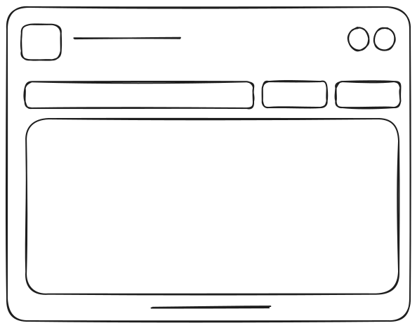

# R001-W01a-contract-list-table
R001 · Contract list page

💬 [Comment on this wireframe on the website ↗](https://saanchi365.github.io/ux-process-requirements/r/R001/#w=R001-W01a)

## Description
test description - this page has filters- that become pills when selected , it has a search and column selector and also a view option - which is basically the filters and the sorting set and saved to be opened in the same manner again in future 

## Open questions
- do we need default view?
